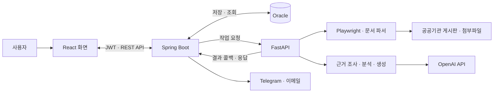

# 현재 시스템 설계

GovInsight는 공공기관 공고를 수집하고 회사 관점의 검토·신청 준비를 돕는다. 이 문서는 **현재 구현의 구조, 주요 동작 계약, 설계 이유와 한계**를 설명한다. 제품 소개는 [README](../README.md), 현재 작업과 미결정 사항은 [PLAN](PLAN.md)을 따른다.

기능이 바뀌면 해당 절을 현재 동작으로 고친다. 날짜별 수정 내역, 실험 비교, 테스트 실행 기록은 이 문서에 누적하지 않는다. 설정값과 프롬프트 전문은 실행 코드에서 관리하며 아래 수치는 코드 기본값 또는 고정 상한이다.

## 구성과 책임

| 구성 | 책임 | 경계 |
| --- | --- | --- |
| React · TypeScript | 모니터링 설정, 공고·분석·비교 조회, 회사 설정, 초안 편집 | Spring Boot API를 사용하며 생성 상태와 저장 결과를 표시한다. |
| Spring Boot · Oracle | 인증, 작업 조율, 변경 판정, 문서 버전, 분석·초안·보고서 저장과 알림 | 데이터 관계와 트랜잭션을 관리한다. 모델 응답을 기다리는 분석 작업은 저장 트랜잭션과 분리한다. |
| FastAPI · Playwright · 문서 파서 | 게시판 수집, 파일 다운로드, 텍스트·표 추출, AI 작업 실행 | 결과를 HTTP로 전달한다. Python에서 Oracle에 직접 접근하지 않는다. |
| LangChain · LangGraph · 모델 어댑터 | 근거 조사, 구조화된 분석·추출·생성, 검증 흐름 | 모델의 의미 판단과 코드의 실행 제어·검증을 구분한다. |

모델 연동은 [openai_models.py](../ai/app/core/openai_models.py)의 OpenAI SDK 어댑터를 사용한다. LangChain 도구 호출·구조화 출력 인터페이스를 유지하면서 네이티브 토크나이저 의존 경로를 분리한다.

## 수집부터 모니터링 완료까지

1. Spring Boot가 수동 또는 예약 실행을 접수하고 작업 ID와 상태를 반환한다.
2. Python이 활성 게시판의 설정된 건수만큼 공고와 첨부를 수집·파싱한다.
3. 수집 결과 콜백을 받은 Spring Boot가 문서 버전과 실행별 감지 이력을 저장하고 신규·수정·변경 없음을 판정한다.
4. 분석이 필요한 문서의 현재 원문, 첨부, 회사 설정과 이전 버전 자료를 Python에 전달한다. 공고 분석 후 필요한 사업 제안을 처리하고 결과를 저장한다.
5. 보고서를 저장하고 설정된 알림 채널의 발송 작업을 처리한다. 사업 제안 대상이 없는 경우도 후속 완료를 전달한다.

`COLLECTED`는 수집 결과 저장 상태이며 전체 완료와 구분한다. 분석·제안·보고서 후속 처리가 끝나야 `COMPLETED`가 된다. 사용자가 양식을 선택해 요청하는 신청서 초안 생성은 별도 작업이다.

자동 일정은 한국 시간을 사용한다. 진행 중인 수동·예약 실행이 있으면 예약 한 건을 DB에 대기시키며 여러 회차를 무한히 쌓지 않는다. 등록된 대기는 재시작 후에도 유지한다. 실행 중 중복 요청, 중복 콜백과 늦게 도착한 이전 시도 결과는 실행·시도 식별자로 구분한다.

기본 게시판과 수집 설정은 [MonitoringSourceDefaults](../backend/src/main/java/com/publicmonitor/backend/domain/monitoring/service/MonitoringSourceDefaults.java), 기관별 수집 방식은 [collectors](../ai/app/domains/monitoring/collectors)에서 관리한다. 수집 건수와 목록 탐색 범위가 정해져 있으므로 수집 완료가 기관의 모든 공고 수집을 뜻하지는 않는다.

### 첨부파일 처리

PDF·HWP·HWPX·DOCX·XLSX와 ZIP 내부 문서에서 텍스트와 표 구조를 읽는다. 파일별 크기·시간·압축 해제 제한을 적용하고, 일부 첨부 실패는 가능한 한 해당 파일의 실패로 격리한다. 읽기 실패를 빈 원문이나 조건 없음으로 바꾸지 않는다.

HWP·HWPX·PDF에는 제한된 VLM OCR 경로가 있다. HWP·HWPX는 로컬 렌더링과 PDF 변환을 거치며 검증 실패 시 기존 추출문을 보존한다. OCR은 기본적으로 게시글당 최대 2개 파일, 파일당 2페이지, 최대 4회 호출이며 자동 재시도하지 않는다. 문서 전체의 모든 표·각주를 읽는다는 보장은 없다. 예산과 활성화 설정은 [vlm_config.py](../ai/app/domains/monitoring/parsers/vlm_config.py)를 따른다.

### 수정 공고의 설명

제목·본문·첨부 정보와 파일 내용의 SHA-256으로 변경을 판정한다. 동일 내용은 문서 버전을 늘리지 않고 유효한 분석을 재사용한다. 분석 누락·실패 또는 갱신이 필요한 결과는 재처리 대상으로 구분한다.

수정 공고 분석은 직전 버전과 비교해 중요한 조건의 **변경 전 → 변경 후 → 회사에 미치는 영향**을 설명한다. 같은 이름의 첨부가 버전별로 하나씩 있을 때 추출 본문을 비교하며, 추가·삭제·읽기 실패·중복 이름은 구분한다. 이름이 다른 파일을 임의로 같은 개정본으로 연결하지 않는다. 이전 자료나 비교 범위가 부족하면 그 한계를 남긴다.

## 데이터와 상세 조회

| 저장 단위 | 역할 |
| --- | --- |
| 문서·문서 버전·첨부 | 공고 식별자와 내용 변경 이력을 보관한다. |
| 모니터링 실행·감지 이력·작업 | 어떤 실행에서 발견했고 어느 단계까지 처리했는지 관리한다. |
| 분석·사업 제안·신청 자격·제출 안내 | 문서 버전과 입력·정책에 연결된 결과를 재사용한다. |
| 상세 표시 결과 | 버전별 화면 응답을 저장해 조회 시 원문 재처리와 AI 실행을 피한다. |
| 사용자별 초안·보고서·발송 이력 | 작성 결과와 알림 처리 상태를 각각 관리한다. |

상세 GET은 제목·분석·첨부 메타데이터와 저장된 표시 결과를 DB에서 읽는다. 신청 자격·제출 안내·사업 유형·담당기관의 원문 처리와 생성은 백그라운드 작업이 수행한다. 아직 새 결과가 없어도 기존 내용과 진행 상태를 반환한다.

`document_detail_snapshots`는 문서 버전과 1:1이며 표시 JSON, 정책 버전, revision과 작업 토큰을 저장한다. 수집·분석·생성 결과가 바뀌면 갱신을 예약한다. 작업자는 누락 버전을 보충하고 최대 2개를 동시에 처리한다. 임대 만료 작업을 회수하고 갱신 시도를 최대 3회로 제한하며, revision과 토큰 검사로 오래된 작업의 덮어쓰기를 막는다. 갱신 중에는 이전 표시 결과를 보존한다.

표시 정책 `document-detail-view-v1`과 신청 자격 추출 정책은 서로 다른 책임이다. 화면 응답이 저장됐다는 사실은 개별 AI 결과의 완전성을 의미하지 않는다. 구현은 [상세 조회](../backend/src/main/java/com/publicmonitor/backend/domain/document/service/DocumentDetailSnapshotReader.java)와 [갱신 작업자](../backend/src/main/java/com/publicmonitor/backend/domain/document/service/DocumentDetailSnapshotWorker.java)를 따른다. 기존 DB의 해당 테이블 추가 SQL은 [document-detail-snapshots.sql](../backend/schema/document-detail-snapshots.sql)에 있다.

## AI 에이전트의 역할과 실행 경계

### 에이전트가 판단하는 부분

공고 분석의 **근거 조사 단계**는 LangChain `create_agent`의 모델·도구 반복 실행을 사용한다. 모델은 제공된 도구 중 다음에 읽을 자료와 조회 순서를 선택하고, 반환된 결과를 보고 추가 조회 또는 종료를 결정한다. 구현은 [AnalysisEvidenceAgent](../ai/app/domains/analysis/evidence/agent.py)에 있다.

| 도구 | 읽는 자료 |
| --- | --- |
| `get_document_content`, `get_attachment_texts` | 현재 공고 본문과 파싱된 첨부의 선택 구간 |
| `get_company_profile` | 전달된 회사 정보와 평가 설정 |
| `compare_previous_version`, `get_previous_analysis` | 수정 공고의 이전 버전 차이와 이전 분석 |
| `search_document_evidence`, `read_document_evidence` | 기본 입력에서 생략된 현재 문서의 표현 검색과 주변 문맥 |

도구는 해당 요청에 제공된 자료만 읽는다. `search_document_evidence`도 현재 문서 안의 표현 검색이며 외부 웹 검색이 아니다. 에이전트에는 임의 파일 접근·DB 쓰기·메일 발송 도구를 제공하지 않는다. 도구 정의와 접근 범위는 [tools.py](../ai/app/domains/analysis/evidence/tools.py)에 모은다.

실행은 다음 순서를 따른다.

1. 코드가 변경 유형과 자료 유무에 따라 필수 도구를 정한다. 현재 공고와 회사 정보는 필수이며, 읽을 수 있는 첨부와 수정 전 자료는 조건에 따라 포함한다.
2. 모델이 도구를 선택하고 결과를 읽는다. 원문이 입력 예산을 넘는 경우에만 추가 검색·문맥 도구를 제공한다.
3. 로컬 검사가 미확인 핵심 구간을 찾으면 [보완 미들웨어](../ai/app/domains/analysis/evidence/recovery.py)가 허용된 검색 또는 읽기를 요구한다. 이때 도구와 인수 범위도 제한한다. 조회 한도가 끝나면 미해결 사항을 남긴다.
4. 코드가 실제 성공한 도구 결과와 필수 조회 여부를 확인한다. 에이전트의 완료 문장 대신 조회한 원문을 후속 분석 입력으로 사용한다.
5. 별도의 구조화 출력 호출로 분석을 작성하고, 코드 검증·점수 계산을 거쳐 결과를 반환한다.

이 구조는 공고마다 필요한 근거와 읽기 순서가 달라지는 부분에 모델 판단을 사용하면서, 필수 자료 누락과 무제한 탐색을 코드로 통제하기 위한 것이다. 보완 단계의 일부 선택은 코드가 강제하므로 모든 판단이 자율적인 것은 아니다.

### 일반 워크플로와의 구분

[DocumentAnalysisWorkflow](../ai/app/domains/analysis/workflow/graph.py)의 LangGraph는 신규·수정·변경 없음 분기, 검증, 제한된 재시도와 완료를 코드로 정의한다. 이 그래프 안에서 근거 조사 에이전트를 호출한다.

신청 자격은 선택된 원문을 한 번 해석한 뒤 검증하는 고정 흐름이다. 제출 유의사항, 사업 제안과 초안 작성도 각각 정해진 생성·검증 절차를 사용한다. 수집·다운로드·파싱·변경 감지·저장·발송은 일반 코드가 담당한다. LangGraph 사용 여부만으로 모든 단계를 자율 에이전트라고 표현하지 않는다.

### 호출과 시간 제한

| 범위 | 현재 제한 |
| --- | --- |
| 근거 조사 1회 실행 | 모델 호출 최대 8회, 도구 호출 최대 8회, 전체 45초 |
| 추가 원문 검색·문맥 조회 | 새 요청 합계 최대 2회, 추가 원문 최대 3,000자. 기존 도구 8회 한도에 포함 |
| 공고 분석 워크플로 | 기본 최대 2회 시도, 시도당 120초. 근거 조사도 해당 시도 시간 안에서 수행 |
| 신청 자격의 일곱 분야 추출 | 모델 호출 최대 1회, 재시도 0회, 호출 120초·대기 포함 처리 150초 |

공고 분석의 시도·시간 설정은 [analysis/config.py](../ai/app/domains/analysis/config.py)를 따른다. 근거 조사 이후의 분석 생성과 조건부 법적 위험 검토, OCR·제안·초안은 각각 모델 호출이 발생할 수 있다. 따라서 근거 조사 한도나 신청 자격 1회 호출을 게시글 전체의 API 비용으로 해석하지 않는다.

## 신청 자격과 라벨

### 추출과 근거 검증

현재 신청 자격의 일곱 분야는 신청 주체, 업력, 매출·수출, 인증·지식재산, 업종·분야, 수행 실적·역량, 신용·재무다. 현재 모집의 자격·전제 약정·제외·우대를 구분하며, 단순 접수 절차나 선정 후 통상 업무를 신청 자격으로 확대하지 않는다.

Spring Boot가 본문과 첨부의 자격 구간, 표 행, 연결된 각주·예외 및 원문 내 사업 범위를 전달한다. Python은 그중 입력 예산에 들어갈 구간을 선택하고 `scope_windows`, 필수 행·구간 정보를 모델에 제공한다. 출처 후보 수와 유료 입력 수는 별개이며, 선택되지 않은 조건을 모두 읽었다고 간주하지 않는다.

[focused.py](../ai/app/domains/participation/focused.py)의 `PROMPT`와 스키마가 실제 추출 계약이다. 일곱 분야 경로는 최대 64출처, 원문 32,000 UTF-8바이트, 전체 입력 예산 48,000바이트, 출력 8,192토큰, 64항목으로 제한한다. 이는 바이트 예산과 출력 토큰 상한이며 실제 청구 토큰 수와 같지 않다. 모델과 추론 강도는 [participation/config.py](../ai/app/domains/participation/config.py)에서 설정한다.

반환된 인용은 원문에 실제 존재하는 연속 구간이어야 한다. 코드가 인용 위치, 사업 범위, 수치·비교 방향·예외와 표 행의 누락 후보를 검사한다. 독립 조건은 분리하고 같은 조건의 대안·정의는 세부 설명으로 연결한다. 일반적인 의미 동등성이나 모든 조건의 완전성을 판정하는 검사는 아니다.

### 사업 유형·적용 사업·신청 구분의 차이

| 표시 | 의미 | 표시 기준 |
| --- | --- | --- |
| 대표 사업 유형 | 공고가 제공하는 핵심 지원 활동의 분류 | 분석 결과와 원문 근거로 대표 유형 하나를 선택한다. 일반 공지·결과 발표를 신규 지원사업으로 확대하지 않는다. |
| 적용 사업 `scope` | 해당 조건이 적용되는 실제 세부 사업·유형 | 인용 위치의 사업·기관 범위를 따른다. 구역 제목, 서식명, 지역·신청 대상 설명만으로 사업명을 만들지 않는다. |
| 신청 구분 `audience` | 해당 조건의 신청 주체·역할 | 인용 및 연결된 자격표 행에 근거가 있는 주체를 표시한다. 다른 사업이나 다른 행의 주체를 가져오지 않는다. |

사업 유형의 코드 계약은 [business_type.py](../ai/app/domains/analysis/workflow/business_type.py), 신청 자격 라벨 검사는 [context_labels.py](../ai/app/domains/participation/context_labels.py)와 백엔드 표시 경로가 담당한다. 근거 없는 라벨을 추정해서 채우지 않으며 라벨 문제만으로 정상 조건 본문을 버리지 않는다.

신청 자격 화면은 표시 검증을 통과한 조건과 지원 제외를 보여주고, 세부 설명과 원문 근거를 펼칠 수 있게 한다. `REVIEW_REQUIRED` 조건과 항목별 품질 안내 상자는 현재 화면에서 숨긴다. 검증 상태와 진단은 서버에 유지하며 안내가 숨겨졌다는 사실을 정확도 보장으로 해석하지 않는다.

### 상태와 재사용

`PENDING`은 처리 중, `READY`는 현재 검사 통과, `PARTIAL`은 일부 미해결, `UNAVAILABLE`은 결과를 제공하지 못한 상태다. 빈 `READY` 결과도 원문 전체에 조건이 없다는 증명은 아니다. 항목의 `VERIFIED` 역시 인용·표시 검사 통과 상태다.

신청 자격 결과는 문서 버전과 입력·정책 키로 DB에 저장한다. 현재 정책은 `participation-condition-contract-v7-scope-ownership`이며 같은 키의 `READY`·`PARTIAL`·`UNAVAILABLE`을 재사용한다. 이전 정책은 백그라운드에서 DB 선점을 거쳐 갱신한다. 조회·재시작만으로 같은 종료 결과의 유료 호출을 반복하지 않는다. 정책 변경 시 재사용과 재생성 범위를 함께 검토한다. 구현은 [ParticipationRewriteService](../backend/src/main/java/com/publicmonitor/backend/domain/document/service/ParticipationRewriteService.java)를 따른다.

## 제출 안내와 회사 관점 검토

### 제출 유의사항의 문맥 기반 정리

제출서류는 원문 표·목록의 서류명과 필수 여부, 제출 대상·조건 및 양식을 연결한다. 표의 머리글·행·셀 내부 목록을 보존하고, 공고의 설명·목차·작성 예시를 실제 제출 의무로 바꾸지 않는다. 담당기관·문의처·접수 URL도 원문과 수집된 링크를 근거로 표시한다.

제출 유의사항은 [submission/service.py](../ai/app/domains/submission/service.py)의 별도 구조화 추출이다. 입력 문맥을 선택해 최대 1회 호출하고 인용·수치·조건을 검증한다. Spring Boot가 버전별 입력 키와 결과를 저장하고 동시 요청을 선점한다. 실패한 동일 입력을 조회마다 유료 재시도하지 않는다. 신청 자격의 호출 한도와 별개다.

### 회사 정보·기회점수·유사 공고

관리자가 회사 정보와 기회점수 기준을 저장한다. 최초 저장 전에도 화면과 동일한 기본 회사 정보·평가 기준을 `revision: 0` 스냅샷으로 분석에 전달한다. 기본값 적용을 위해 설정 레코드를 자동 생성하거나 사용자에게 저장을 요구하지 않는다. 저장 후에는 해당 저장 버전의 값을 사용한다. 관심 분야와 실제 보유 역량을 구분하고 완료·진행·계획 실적을 섞지 않으며, 미확인 정보를 공식 자격이나 확보된 역량으로 단정하지 않는다.

기회점수는 회사 적합도·사업 매력도·실행 가능성·긴급도 등의 판단과 코드 산식을 결합한다. 검색·필터는 저장된 점수와 우선순위를 사용한다. 점수는 검토 순서를 돕는 값이며 선정 확률을 뜻하지 않는다.

기본 설정과 사용자 저장 설정 모두 실행 가능성은 기존 분석 생성 호출에서 자격 증빙·기술 대응·완료 실적·가용 인력·필수 서류 및 파트너에 대한 상태와 짧은 근거를 받는다. 모델은 실행 가능성의 점수와 종합 설명을 작성하지 않는다. [feasibility_scoring.py](../ai/app/domains/analysis/workflow/feasibility_scoring.py)가 항목별 배점과 설명을 함께 만든다.

- 자격 증빙은 확인 30·미확인 10·미충족 0점, 기술은 직접 대응 25·확보한 파트너 보완 15·미확인 0점이다.
- 완료 실적은 증빙 및 인정 확인 20·등록만 확인 10·없음 0점이다. 회사에 완료 실적이 등록되지 않았다면 진행·계획 실적을 가점으로 쓰지 않는다.
- 준비 여건은 분석일 기준 남은 일수가 설정한 최소 준비 기간 이상이고 인력도 확인되면 15점, 기간 또는 인력이 미확인이면 5점, 기간 부족·접수 종료·인력 투입 불가이면 0점이다. 날짜가 불명확하거나 상시 접수이면 기간이 충분하다고 단정하지 않는다.
- 필수 서류·인증·파트너는 확보 확인 10·미확인 5·미충족 0점이다. 공동 참여 선호만으로 파트너를 확보했다고 판단하지 않는다.
- 직접 자격 또는 필수 파트너 미확인은 최대 45점, 신청 불가·접수 종료·명시적 필수 조건 미충족은 최대 20점으로 제한한다. 최종 신청 자격 판단도 상한에 반영한다.

긴급도는 마감일과 사용자의 집중 대응 기간으로 계산한다. 회사 적합도·사업 매력도의 항목 판단과 점수는 모델이 작성하며, 최종 가중 합계와 우선순위는 Spring Boot가 설정 프리셋으로 계산한다. 실행 가능성의 근거 판단 자체와 원문 추출의 정확성까지 코드로 보장하는 것은 아니다. 별도 채점 검토 호출은 추가하지 않으며 실제 토큰 사용량과 지연은 생성 결과에 따라 달라진다.

내부 분석 결과의 `opportunity`는 기존 네 `dimensions`와 `settingsRevision`에 `scoringPolicyVersion`을 포함한다. 새 채점은 기본 설정을 포함해 정책 버전 1이다. `settingsRevision: 0`은 최초 저장 전의 기본값을 뜻하며, 구형 채점 여부는 `scoringPolicyVersion`으로 구분한다. 정책 버전 미전달과 구형 요청은 0으로 취급한다. 항목별 중간 판단은 내부에서만 사용하고, 최종 점수·근거와 정책 버전은 기존 JSON에 저장하므로 DB 스키마 변경은 없다. 다음 모니터링에서 다시 수집된 공고는 설정 저장 여부와 관계없이 정책 버전이 낮으면 전체 분석을 갱신한다. 동일 설정의 새 정책 결과는 한 번 교체하며, 늦게 도착한 이전 정책 결과가 이를 덮어쓰지 않는다. 조회만으로 유료 분석을 실행하거나 모든 저장 공고를 즉시 재생성하지는 않는다. AI와 백엔드를 함께 반영해야 한다.

유사 공고는 저장된 임베딩과 제목·사업 목적의 어휘 순위를 결합하고 주제 충돌과 공통 근거를 검사해 최대 3건을 반환한다. 미확인 안내 문구는 검색 근거에서 제외한다. 문서 특징과 통계를 캐시하며 조회마다 추가 모델을 호출하지 않는다.

## 사업 제안·신청서 초안·보고서

사업 제안은 회사와 공고의 관계를 바탕으로 참여 방향, 논의할 사항과 준비 조건을 정리한다. 공고의 의무와 AI의 제안을 구분하고 회사에 확인되지 않은 실적·인력·인증을 보유 사실로 쓰지 않는다.

초안은 선택한 버전의 첨부·ZIP 내부 양식에서 실제 사업·연구·협력 작성란을 확인한 뒤 생성한다. 파일명만으로 대상을 확정하지 않고 원문 항목, 언어와 인용을 검증한다. 재작성 중에도 기존 저장본을 보존하며 새 결과가 검증된 경우 교체한다. 요청 식별자와 저장 버전으로 중복 요청·동시 덮어쓰기를 제어하고 직전 초안 복원을 제공한다. 생성 계약은 [proposals/writer.py](../ai/app/domains/analysis/proposals/writer.py), 저장은 [ProposalDraftStore](../backend/src/main/java/com/publicmonitor/backend/domain/document/service/ProposalDraftStore.java)가 담당한다.

보고서는 저장된 분석·제안과 제출 안내를 재사용한다. 기본 보고서를 먼저 저장하고 필요한 안내를 보강한 뒤 발송 대기 상태로 전환한다. 일부 생성이 실패해도 확보된 내용을 보존하며, 기본본 발송 후 보강본을 다시 자동 발송하는 방식으로 처리하지 않는다.

Telegram과 이메일은 채널별 설정·수신자·발송 상태를 관리한다. 수신자별 시도와 잠금으로 중복 요청을 제어하고 채널 실패를 격리한다. 외부 전송 후 DB 저장이 실패하는 경우까지 정확히 한 번 수신을 보장하지는 않는다. 접수 여부가 불확실한 전송은 자동으로 반복하지 않는다.

## 실패 처리와 결과 전달

수집·분석·제안·보고서·상세 갱신은 각 단계의 상태와 제한된 복구 정책을 가진다. 작업 임대와 현재 시도 식별자로 재시작 후 작업을 회수하고 늦은 결과가 최신 결과를 덮어쓰지 않게 한다. 수집 실패, 생성 실패, 결과 저장 실패와 알림 전송 실패를 구분한다.

Python은 구조화 출력과 Pydantic 검증을 거쳐 결과를 전달하고 Spring Boot도 저장 계약을 검사한다. 결과 API의 명시적 거절은 [analysis_result_client.py](../ai/app/domains/analysis/clients/analysis_result_client.py)의 실패 통지 경로로 현재 작업에 연결한다. 전송 재시도와 모델 재생성은 별개이며 모든 실패를 무조건 재호출하지 않는다.

진단에는 실행·문서 버전 식별자, 성공한 도구명, 호출 단계·지연·사용량과 안전한 오류 코드를 사용한다. 모델의 내부 추론, 비밀정보, 원문·모델 응답 전문을 진단 로그에 남기지 않는다. 호출 계측은 [model_calls.py](../ai/app/observability/model_calls.py)에서 관리한다.

## 접근 권한과 구현 한계

사용자 API는 JWT 인증을 사용하며 회사 평가 설정·알림 설정과 통합 발송 이력에는 관리자 권한을 적용한다. 현재 백엔드의 `/internal/**`는 JWT 인증 대상에서 제외되어 있다. 내부 HTTP 경로를 신뢰할 수 있는 네트워크로 제한하는 배포 경계가 필요하며, 내부 API 자체의 인증이 구현돼 있다고 가정하지 않는다.

공고·첨부와 도구 결과의 문장은 분석 데이터로 취급한다. 모델에게 제공한 읽기 도구와 입력 범위를 벗어난 실행 권한을 부여하지 않는다. API 키·DB 비밀번호·발신 계정 정보는 로컬 설정이나 환경변수로 관리한다.

현재 품질의 한계는 수집 범위, 첨부 파싱·OCR 범위, 모델 입력 선택, 의미 추출과 표시 검증에 각각 존재한다. 특히 긴 표의 대안·각주 누락, 사업·신청 주체 혼동과 라벨 정확도를 코드 검사만으로 완전히 보장하지 않는다. 테스트 통과나 처리 완료 상태를 실제 공고 전체의 정확도·완전 수집률로 보고하지 않는다.

실행·설정 방법은 [백엔드 안내](../backend/README.md)와 [AI 모듈 안내](../ai/README.md)를 따른다. 현재 요청·응답 스키마는 백엔드 API 문서와 FastAPI `/docs`, 각 모듈의 DTO·스키마를 기준으로 확인한다.
